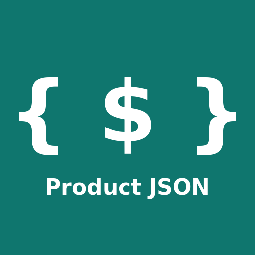

# Product Page Extractor: remote MCP server



**For e-commerce and pricing teams: turn any product page URL (or HTML you already have) into clean JSON with price, stock, brand and identifiers.**

**1. Connect** (free, no key; works in Claude Desktop, Cursor, Cline, VS Code and any client that supports remote Streamable HTTP):

```json
{
  "mcpServers": {
    "product-extractor": {
      "url": "https://product-extractor.mohamed-bahaa53000.workers.dev/demo/mcp"
    }
  }
}
```

**2. Ask:** *"What's the price and stock status of https://www.allbirds.com/products/mens-tree-runners?"* Your agent calls:

```json
{"name":"extract_product","arguments":{"url":"https://www.allbirds.com/products/mens-tree-runners"}}
```

**3. Get** (real output from the free demo endpoint, trimmed):

```json
{"name":"Men's Tree Runner","brand":"Allbirds","price":100,"currency":"USD","in_stock":true,"price_source":"json-ld"}
```

## What makes it different

- **Shows where the price came from.** Each result has a `price_source` field (`json-ld`, `microdata`, `meta`, or `null`), so your agent can tell a structured price apart from a guess. If a page renders its price with JavaScript, you get `null` rather than a wrong number.
- **Works on raw HTML, not just URLs.** Already scraped the page, or the site blocks bots? Pass the `html` (up to 2 MB) and skip the fetch.
- **Returns every offer, not just the first price:** variants, sellers and sale prices, up to 50 per page.
- **LLM-ready Markdown** of the page with `include=markdown`, or the raw JSON-LD blocks with `include=jsonld`.
- **MCP-native with a free, keyless demo endpoint**, so an agent can try it with one line of config.

It doesn't get past anti-bot pages (Amazon, Best Buy, REI) and doesn't run JavaScript. For those, fetch the HTML yourself and pass it in.

## No-code version

Not building an agent? **[Try it free in your browser](https://product-extractor.mohamed-bahaa53000.workers.dev/demo/v1/extract?url=https://www.allbirds.com/products/mens-tree-runners)**: no key or sign-up, 10 pages a day. Swap the `url=` value for any product page and you get the JSON back.

## Try it free

- **No key, right now:** point any MCP client at `https://product-extractor.mohamed-bahaa53000.workers.dev/demo/mcp` (10 tool calls per IP per day).
- **Free RapidAPI plan:** 50 requests/month on the [Basic plan](https://rapidapi.com/MohamedBahaa/api/product-page-extractor/pricing), no card needed. Pro is $9.99 for 5,000.

This is a **hosted (remote) MCP server** using Streamable HTTP. There's nothing to install or run locally. This repository holds only the documentation and the MCP Registry manifest; the server code is not open source.

| Endpoint | Auth | Limits |
|---|---|---|
| `https://product-extractor.mohamed-bahaa53000.workers.dev/demo/mcp` | none | free, 10 tool calls per IP per UTC day, no batch |
| `https://product-page-extractor.p.rapidapi.com/mcp` | `X-RapidAPI-Key` + `X-RapidAPI-Host` headers | paid per request via [RapidAPI](https://rapidapi.com/MohamedBahaa/api/product-page-extractor) (free Basic plan available) |

Official MCP Registry name: `dev.workers.mohamed-bahaa53000.product-extractor/product-page-extractor`

## Tools

- `extract_product`: `url` or `html`, plus an optional `include` (`product,meta,markdown,jsonld`). Data is read from schema.org JSON-LD, microdata and OpenGraph.
- `extract_batch`: up to 10 URLs in one call, with ok/error for each page (**paid endpoint only**).

## Use cases

- Price and stock checks for agents doing competitor monitoring.
- Catalog enrichment: GTIN/MPN/brand for product matching.
- Turning a product page into Markdown for an LLM to read.

## Examples

Ask your agent: *"What's the price and stock status of https://www.allbirds.com/products/mens-tree-runners?"* It calls:

```json
{"name":"extract_product","arguments":{"url":"https://www.allbirds.com/products/mens-tree-runners"}}
```

Already have the HTML (from your own crawler, or a site that blocks bots)? Pass it in and skip the fetch:

```json
{"name":"extract_product","arguments":{"html":"<html>...</html>","include":"product,markdown"}}
```

Plain REST works too:

```bash
curl "https://product-extractor.mohamed-bahaa53000.workers.dev/demo/v1/extract?url=https://www.allbirds.com/products/mens-tree-runners"
```

## Connect

```json
{
  "mcpServers": {
    "product-extractor": {
      "url": "https://product-extractor.mohamed-bahaa53000.workers.dev/demo/mcp"
    }
  }
}
```

Paid / production (RapidAPI):

```json
{
  "mcpServers": {
    "product-extractor": {
      "url": "https://product-page-extractor.p.rapidapi.com/mcp",
      "headers": {
        "X-RapidAPI-Key": "YOUR_RAPIDAPI_KEY",
        "X-RapidAPI-Host": "product-page-extractor.p.rapidapi.com"
      }
    }
  }
}
```

For clients that only support stdio: `npx -y mcp-remote https://product-extractor.mohamed-bahaa53000.workers.dev/demo/mcp`

## Notes

- Stateless. Pages and HTML aren't stored beyond standard request logs.
- Only fetches public http/https pages.

## License

MIT for this repository's docs and config examples (see [LICENSE](LICENSE)). The hosted service is proprietary.
